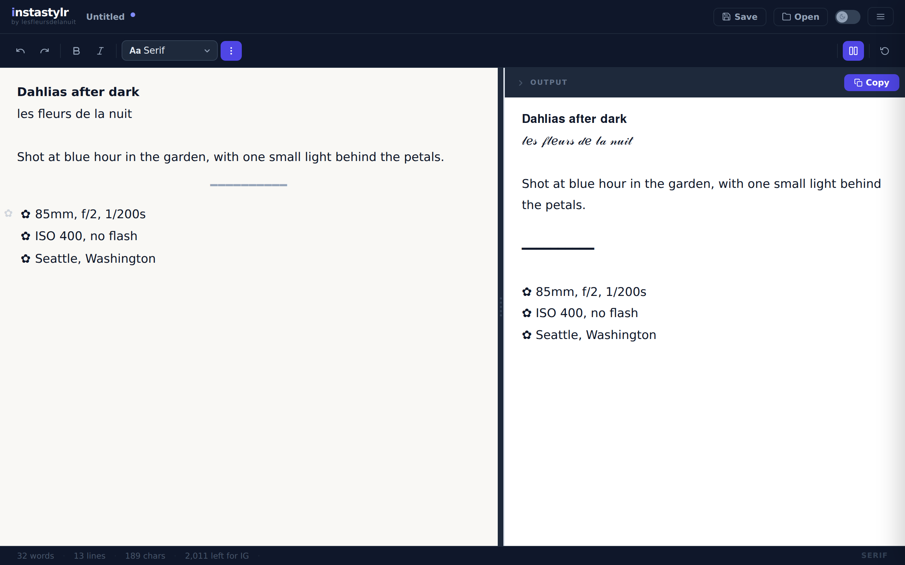
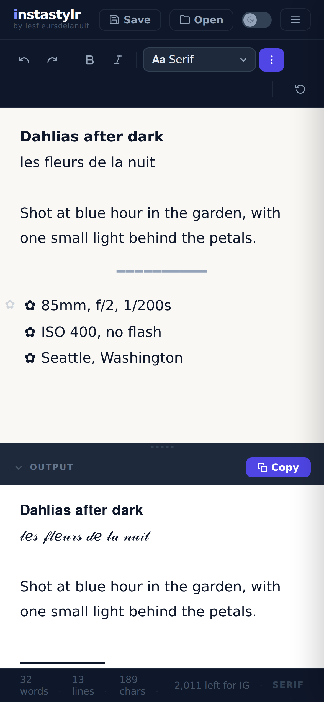
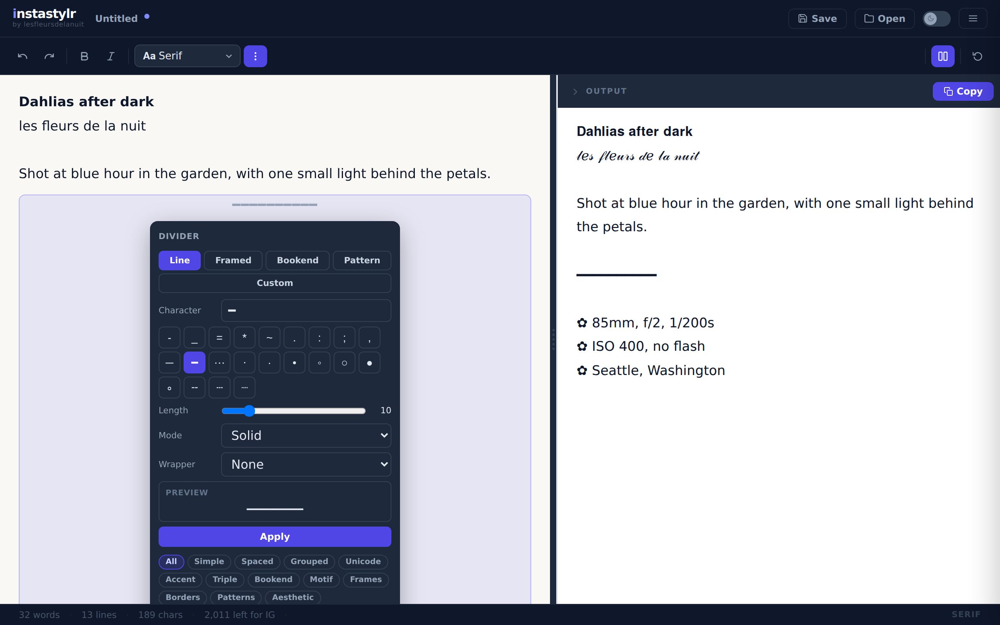
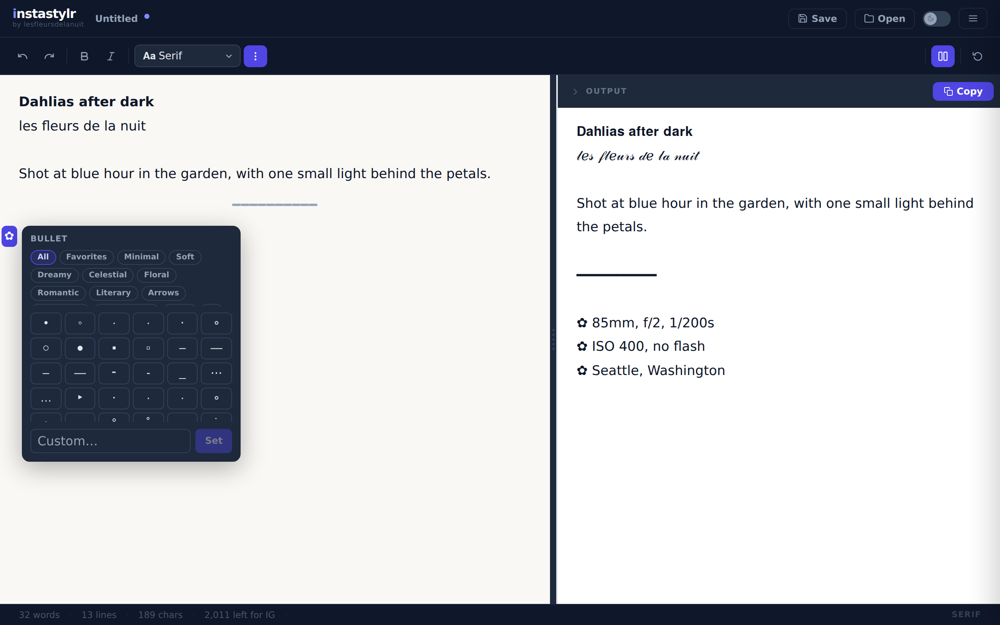
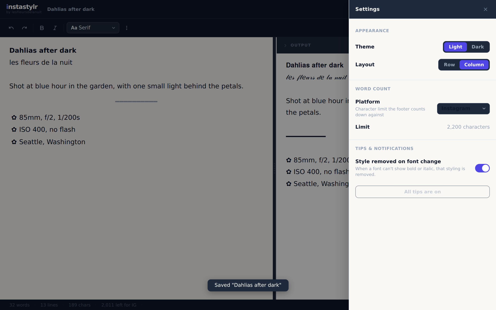
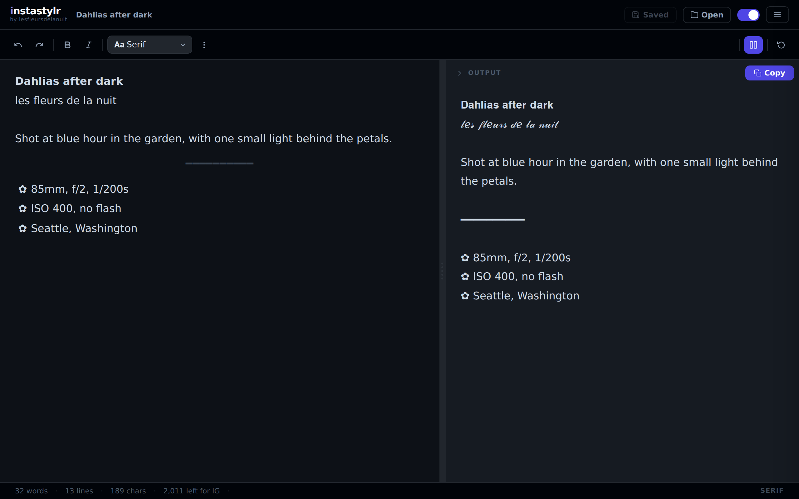

# InstaStylr

A caption editor for Instagram and other places that only accept plain text. You write with bold, italic, fonts, lists and dividers, and it gives you plain Unicode text that keeps the look when pasted. It is live at **[instastylr.lesfleursdelanuit.com](https://instastylr.lesfleursdelanuit.com)**.

I designed and built InstaStylr. It is about 5,100 lines of TypeScript with 103 unit tests and 10 Playwright browser tests. It is a static site: there is no server code, no account and no tracking, and everything you write stays in your browser.

**Short on time?** [The architecture in five minutes](docs/OVERVIEW.md) covers how it's built, why, the tradeoffs and the known limits.

## Why it exists

Instagram, YouTube, TikTok and most social platforms strip formatting when you paste. The usual workaround is a "fancy text generator": a box that converts one line at a time. I write captions for my flower photography and wanted a real editor instead, where I can style part of a sentence, keep a list of camera settings under it, save the caption and come back to it.

## Screenshots

<p align="center">
  
  
</p>
<p align="center"><b>Editor and output</b>: what you write, and the plain text that gets copied &nbsp;·&nbsp; <b>On a phone</b></p>

| | |
|---|---|
|  |  |
| **Divider builder**: a line built from a recipe, with a live preview | **Bullet picker**: 290 markers, or any character of your own |
|  |  |
| **Settings**: theme, layout, and which platform's limit to count against | **Dark theme**, with the caption saved under a name |

## What it does

- **Bold, italic and eight fonts** (default, sans-serif, script, Fraktur, monospace, double-struck, fullwidth, circled), applied to a selection or to what you type next.
- **A live output panel** that always shows the exact text that will be copied.
- **Lists** with a bullet of your choice per list, and numbered lists.
- **Dividers** built from a recipe (line, framed, bookend, pattern) or picked from 209 presets.
- **A character counter** that counts what a person sees as one character, against the limit of Instagram, YouTube, TikTok, X, Threads, Facebook or LinkedIn.
- **Saved posts** in the browser, with a clear state: untitled, saved, or changed since the last save.
- **An emoji picker**, a starter template for photo captions, light and dark themes, and a side-by-side or stacked layout.

## How it is built

- **Stack:** React 18, TypeScript, Vite and [Lexical](https://lexical.dev) (Meta's editor framework). Tests run on Vitest and Playwright.
- **One direction only.** The Lexical document is the source of truth. The output is a projection of it, rebuilt on every change and never parsed back (`src/editor/serialize.ts`).
- **Fonts are data.** A "font" is a table that maps ASCII onto look-alike Unicode characters. Adding a font means adding a table (`src/fonts/mappings.ts`), with the known gaps in Unicode's math alphabets listed as exceptions.
- **No backend.** State lives in `localStorage`. The site is served as static files with a strict Content-Security-Policy (`deploy/`).

## Repository layout

| Path | What is there |
|---|---|
| `src/fonts/` | The font tables and the transform that applies them |
| `src/editor/` | The Lexical editor: nodes, plugins, and the projection to plain text |
| `src/editor/divider/`, `src/editor/bullet/` | Divider recipes and presets, bullet presets |
| `src/ui/` | Panels and dialogs: saves, settings, menu, welcome |
| `src/App.tsx` | The document state: identity, unsaved changes, guarded actions |
| `e2e/` | Playwright browser tests |
| `deploy/` | The deploy script and the nginx headers the site is served with |
| `docs/` | Design notes: the state model, the divider spec, the overview |

## Tests

| Suite | Tests | Result (2026-10-10) |
|---|---|---|
| Unit (Vitest), 11 files | 103 | all pass |
| Browser (Playwright, Chromium) | 10 | not run in this check |

The unit tests cover the font transform (48 cases, including every gap in the Unicode math alphabets), the projection to plain text, lists, dividers, the counter and saved posts. The browser tests drive the real app: typing, styling, copying, saving and the confirm-before-discard guards.

### Running it yourself

Needs Node.js 20 or newer.

```sh
npm install
npm run dev        # http://localhost:5173
npm test           # unit tests
npm run test:e2e   # browser tests (needs: npx playwright install chromium)
npm run build      # static site in dist/
```

## History

[CHANGELOG.md](CHANGELOG.md) lists the milestones by date.

## How I work

A feature that changes how the app behaves starts as a written note in `docs/` with the decisions taken. [docs/STATE_MODEL.md](docs/STATE_MODEL.md) is the note behind saving and unsaved changes, and [docs/DIVIDER_PRESETS.md](docs/DIVIDER_PRESETS.md) is the divider spec.

## Notes

Styled Unicode text has a cost: screen readers read these characters badly or skip them, and search does not match them. Use it for a heading or an accent, and keep the words that matter in plain text. [The overview](docs/OVERVIEW.md) lists this and the other known limits.

## Licence

The code is released under the [MIT licence](LICENSE).

Two things in this repository are not covered by it:

- **The photographs** in `src/landing/photos/` are © Monica Gonsalves (Les Fleurs de la Nuit), all rights reserved. See [`src/landing/photos/NOTICE.md`](src/landing/photos/NOTICE.md).
- **The fonts** in `src/landing/fonts/` (Bodoni Moda and Manrope) are under the SIL Open Font License 1.1; their licence texts sit next to the font files.

